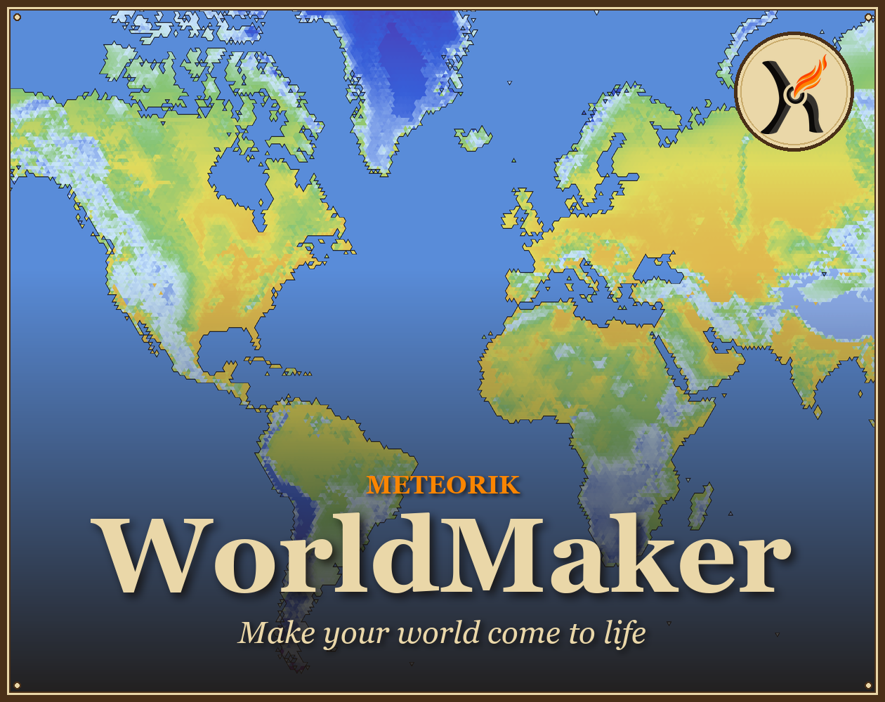
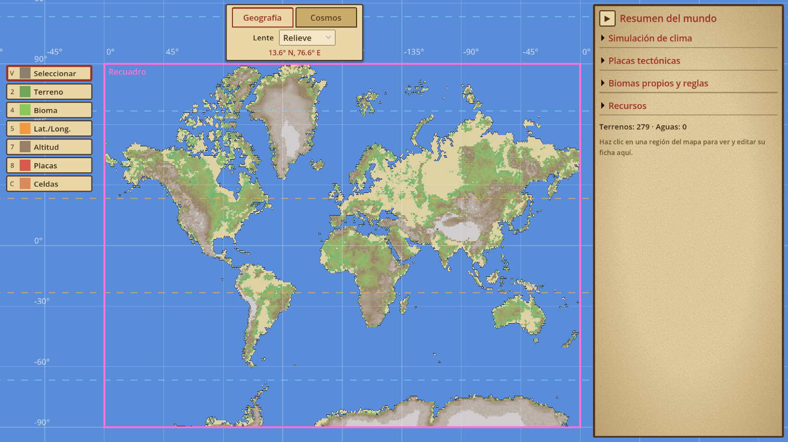
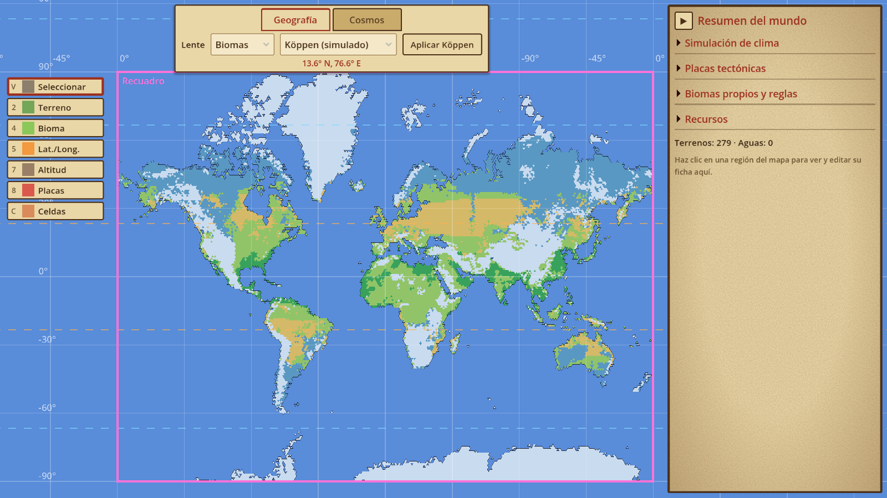
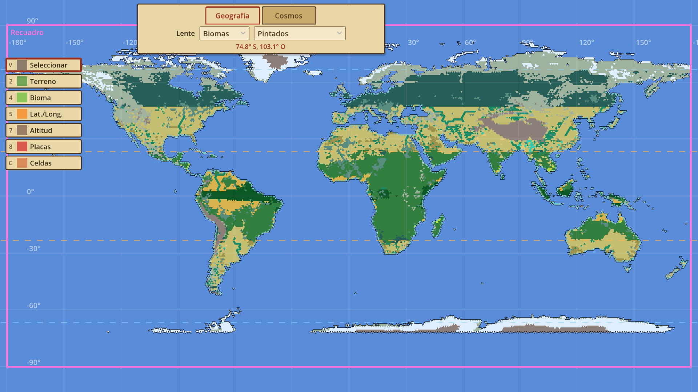
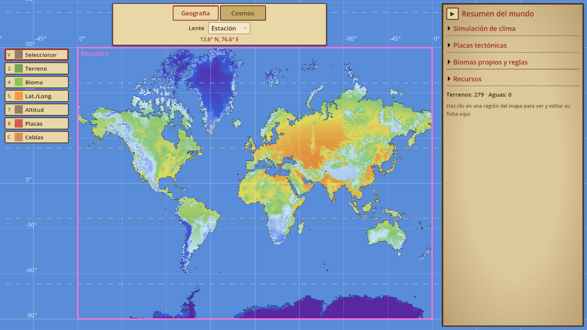
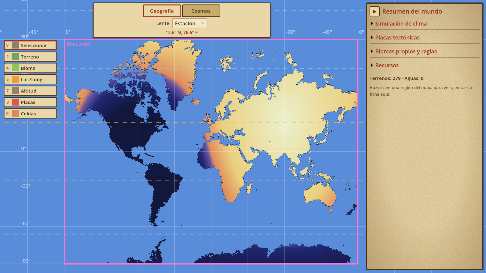
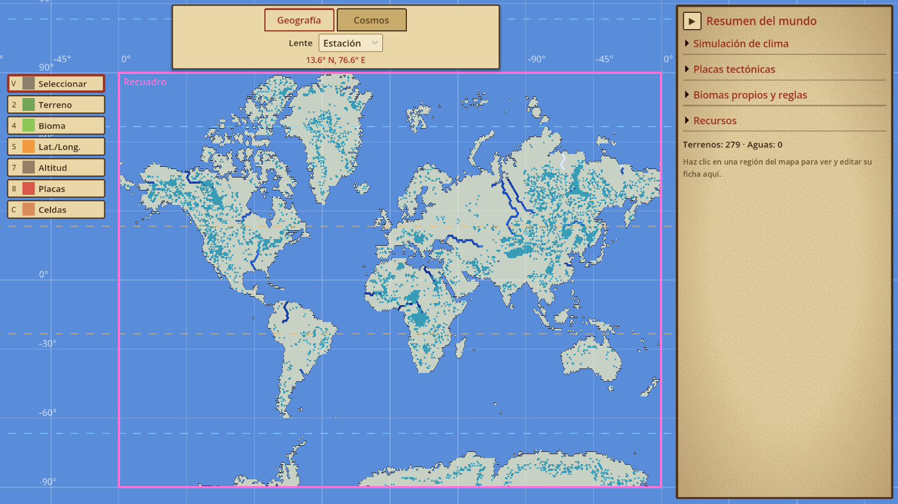
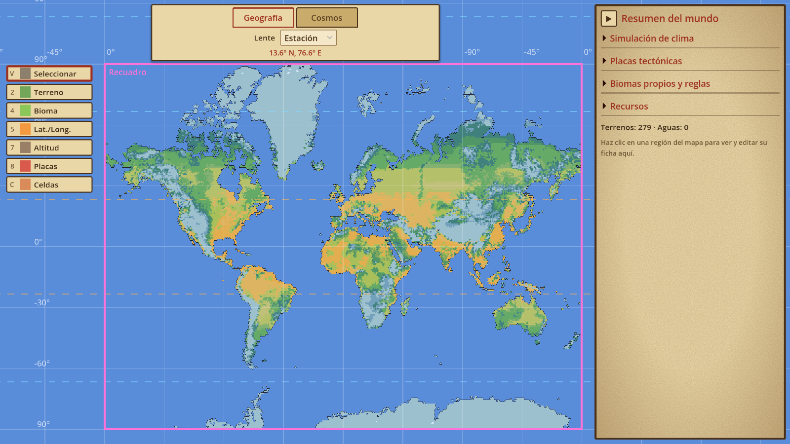
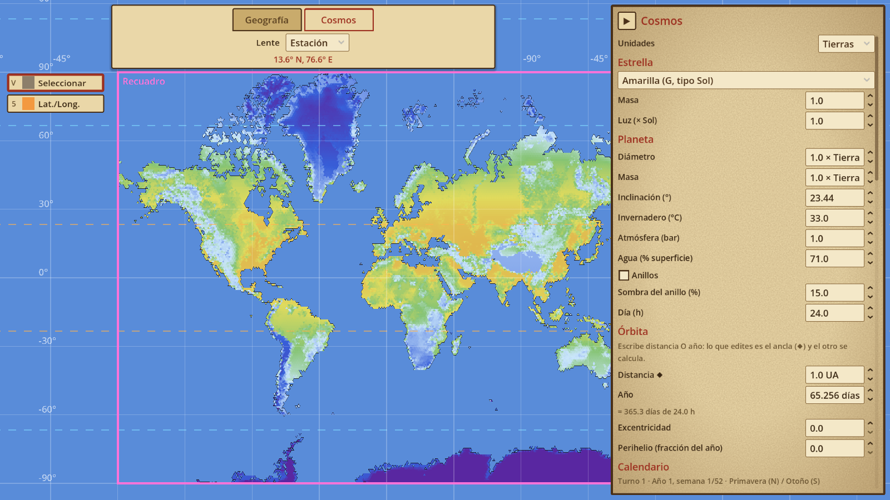

# Meteorik WorldMaker

**[Download or play in your browser on itch.io](https://meteori-k.itch.io/worldmaker)** (free)

A free tool to build a world from scratch and see how its planet behaves. Paint the land, set the star, the tilt and the moons, shape the relief, and let the simulation work out the climate, the seasons, the tides, the rivers and the biomes.

Made with Godot 4.7. Interface in Spanish and English (Options, Language).

## What it does

- **Paint your world** on a triangular grid: land and water regions, altitude brushes, tectonic plates, biomes.
- **Set up the planet**: star type, planet size and mass, axial tilt, day and year length, moons. Derived numbers (gravity, habitable zone, tropics) update as you go. Even odd planets work, such as an 82 degree tilt.
- **Climate that follows from physics**: temperature with thermal lag, circulation cells (an Earth-like regime and an extreme-tilt one), wind-carried moisture, rain shadows behind mountains, ocean currents, continentality.
- **Seasons, time of day and tides**: look at any month of the year, see snow and vegetation change, set a clock and watch temperature and sun height at dawn, noon, dusk and midnight, with tides from the moons that also shape the climate of the land they cover.
- **Orbit with eccentricity**: summers and winters stop being equal.
- **Hydrology**: rivers and lakes from the relief and the rain.
- **Biomes** from the Koppen, Holdridge and Holdridge+ systems (heat stress, best and worst season), plus a set of extra biomes (riverside forest, oasis, wetland, monsoon forest, dry savanna) and your own.
- **Resources** per cell, derived from climate, altitude and plates.
- Save and load worlds as files; export to SVG on desktop.
- **Export the whole world** as CSV or JSON: every tile with 12 periods of temperature, rain, humidity, wind, insolation, sunshine hours and snow.
- Airbrushes in the altitude tool (raise, lower, smooth) with protected height ranges.

## Screenshots

An Earth-like planet imported from a hypsometric map with the Import map tool.

Temperature at local noon, everywhere at once:

Sun height at dawn:

Simulated rivers and lakes:

Holdridge+ zones:

The Cosmos tab: star, planet, orbit and calendar:

## Download

Windows build and browser version, free: **https://meteori-k.itch.io/worldmaker**

## About this repository

This repository only holds the public face of the project: this page, screenshots and release notes. The source lives in a private repository, and the same code also powers a larger game edition (countries, cities, turns, a world book and an optional local AI narrator) which is not part of this free tool. Worlds you make here open in that edition too.

Copyright (c) Meteorik. All rights reserved.
